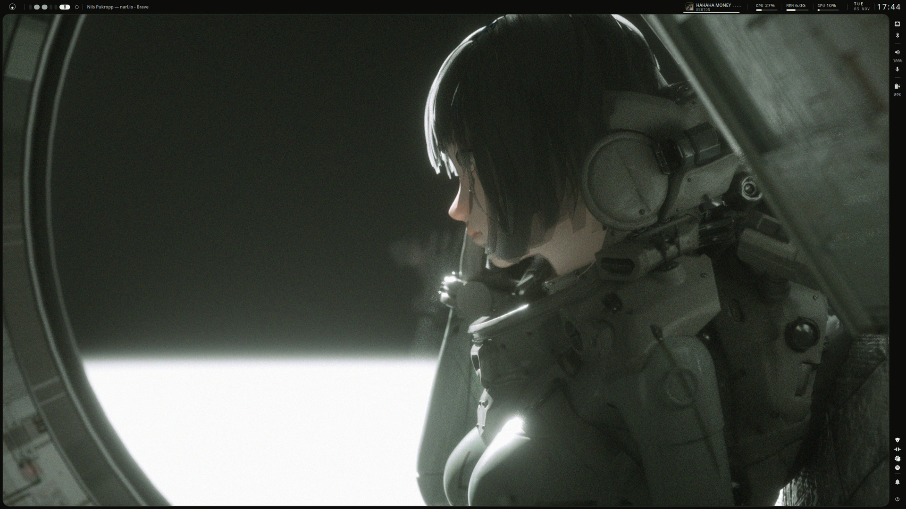
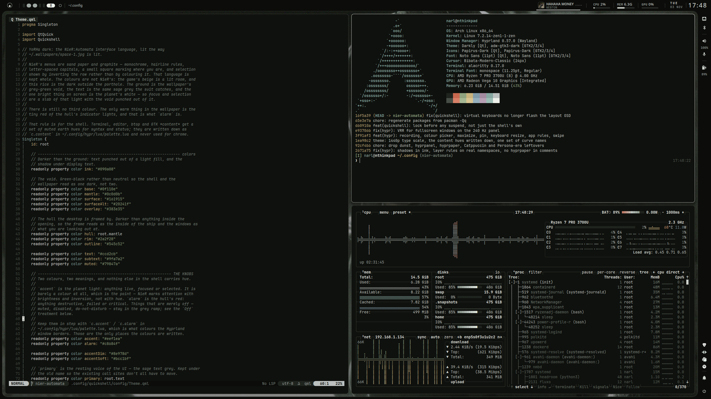
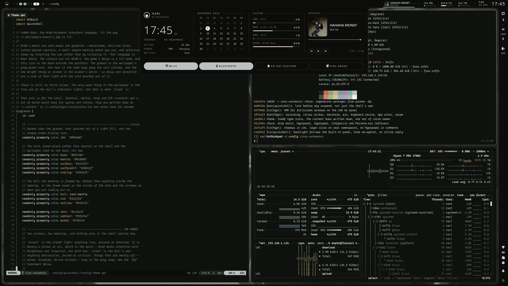
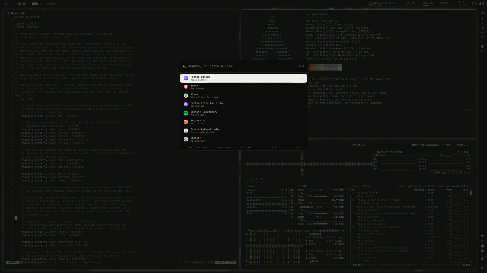
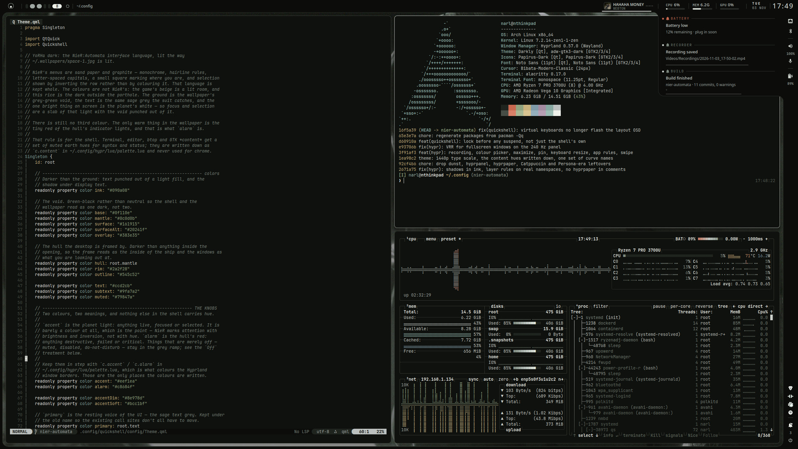
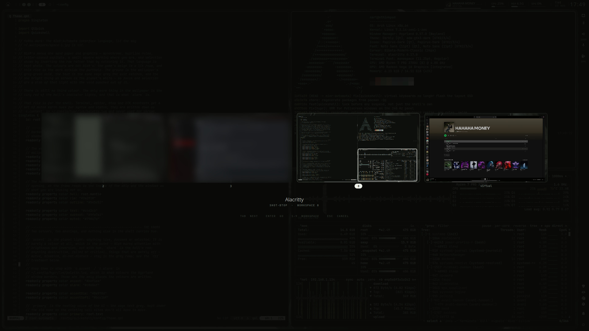
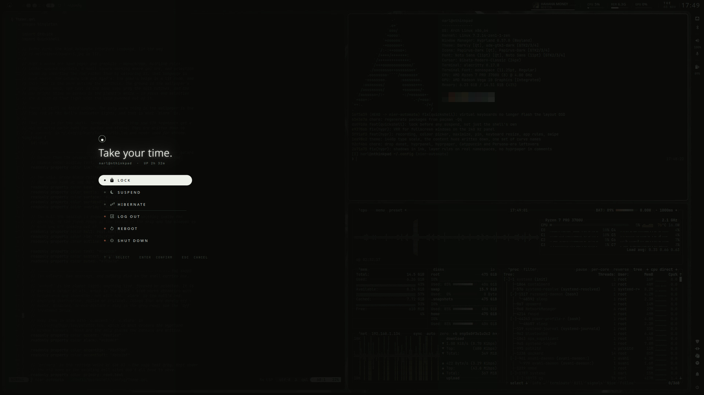
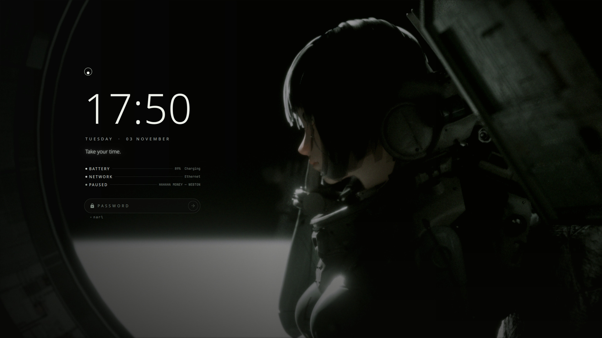

# YoRHa dark — dotfiles

A NieR:Automata-flavoured Hyprland desktop on Arch, kept dark and lit like its
wallpaper: grey-green void, one planet's white for anything live, the hull's
red for anything wrong. The bar, a status rail and a thin border are one hull
around the desktop, drawn by a [Quickshell](https://quickshell.org) shell that
also does notifications, the launcher, the lock screen, idle and the wallpaper.

| | |
|---|---|
|  |  |
| Dashboard (`SUPER+D`) — time, month, meters, player, quick switches | Launcher (`SUPER+SPACE`) — apps, `>` shell, `=` calc, `:` clipboard, `;` emoji, `?` keys, `@` wallpaper |
|  |  |
| Notifications, grouped by sender in the bell's log | Overview (`ALT+TAB`, `SUPER+W`) — every workspace, live |
|  |  |
| Power menu (`SUPER+P`) | Lock screen |

## What is here

| Path | What |
|---|---|
| [`hypr/`](hypr/README.md) | Hyprland 0.57, Lua config: binds, rules, look, monitors, scripts |
| [`quickshell/`](quickshell/README.md) | the shell: bar, rail, popouts, dashboard, launcher, notifications, OSD, lock, overview, ask panel |
| `alacritty/`, `fish/`, `nvim/` (submodule), `btop/`, `zathura/` | terminal, shell, editor, monitor, PDF — all on the YoRHa palette |
| `gtk-3.0/`, `gtk-4.0/`, `qt6ct/` | GTK (adw-gtk3-dark + css) and Qt (Darkly + colour scheme) |
| `fluxo/` | the system-stats daemon the bar reads CPU/MEM/GPU from |
| `systemd/` | user units (mounts, agents, the dunst mask) |
| `packages` | `pacman -Qq` of the machine |

The palette is written once per program; the two shell colours live in
`quickshell/config/Theme.qml` and `hypr/lua/palette.lua`. See
[Palette discipline](quickshell/README.md#palette-discipline) for the full list.

## Keys

`SUPER` is the modifier.

| Keys | Does |
|---|---|
| `SUPER+RETURN` / `E` / `SPACE` | terminal / files / launcher |
| `SUPER+D` / `W` / `A` / `P` | dashboard / overview / ask Claude / power menu |
| `SUPER+CTRL+L` | lock |
| `ALT+TAB` | switch windows across every workspace |
| `ALT+M` | clipboard history |
| `SUPER+H/J/K/L` | focus; `+SHIFT` moves, `+ALT` resizes |
| `SUPER+1…0` | workspace; `+SHIFT` moves the window there |
| `SUPER+S` | scratchpad; `+SHIFT` sends the window there |
| `SUPER+F` / `SUPER+SHIFT+F` | fullscreen / maximize |
| `SUPER+V` / `SUPER+O` / `SUPER+SHIFT+Q` | float / pin / close |
| `SUPER+N`, `SUPER+TAB` | group, cycle the group |
| `PRINT` | screenshot an area (`+CTRL` the window, `+SHIFT` to a file) |
| `SUPER+PRINT` | record an area (`+SHIFT` the monitor); again to stop |
| `SUPER+SHIFT+C` | colour picker |
| `SUPER+.` / `SUPER+/` / `SUPER+SHIFT+W` | emoji / keybind cheatsheet / wallpaper (launcher modes `;` `?` `@`) |
| `SUPER+SHIFT+N` / `I` | do not disturb / stay awake |
| `SUPER+SHIFT+R` | reload the shell |

`hyprctl binds` lists everything, with descriptions.

## Setup

Arch, with `hyprland`, `uwsm`, `quickshell`, and from `packages`: `grim`,
`slurp`, `satty`, `wf-recorder`, `hyprpicker`, `wl-clipboard`, `cliphist`,
`brightnessctl`, `playerctl`, `hyprpolkitagent`, `adw-gtk-theme`, `darkly-bin`,
`papirus-icon-theme`, `bibata-cursor-theme-bin`, `noto-fonts`,
`ttf-jetbrains-mono-nerd`. `fluxo` is a cargo install. Optional:
`hyprsunset` (night light switch), `gpu-screen-recorder` (`ALT+Z` replay).

Clone into `~/.config` (the `.gitignore` is an allowlist), start Hyprland
through uwsm, and `hypr/lua/autostart.lua` brings up the shell. The wallpaper
path is the one line in `quickshell/wallpaper`.
